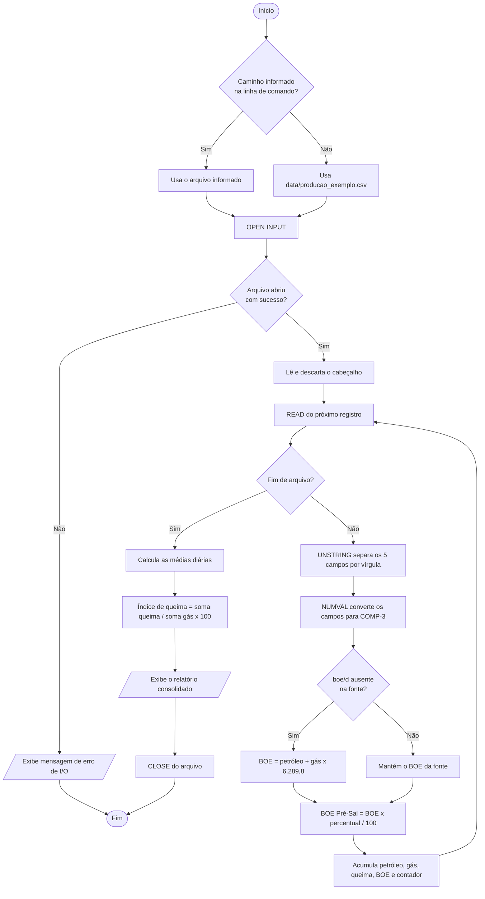

# Inteligência Energética: Sistema de Processamento Batch em COBOL para Indicadores de Produção de Petróleo e Gás Natural


-D97706?style=for-the-badge)


## Resumo Executivo
Este repositório apresenta o desenvolvimento de uma aplicação analítica em **COBOL (padrão GnuCOBOL 3.x)** voltada ao processamento em lote (*batch processing*) de séries temporais da indústria de exploração e produção de petróleo e gás natural (E&P). O sistema realiza a ingestão de arquivos estruturados em formato CSV, executa rotinas de conversão volumétrica para determinação de Barris de Óleo Equivalente por dia (`boe/d`) e consolida indicadores operacionais de produção do horizonte Pré-Sal e de eficiência ambiental (índice de queima de gás natural / *flaring*). O projeto alia a robustez aritmética de precisão fixa do COBOL (`COMP-3` / *Packed-Decimal*) às práticas contemporâneas de engenharia de dados e governança da informação.

---

## 1. Objetivos do Sistema
* **Ingestão e Parsing Sequencial:** Ler e processar arquivos de dados mensais estruturados em formato CSV (*Comma-Separated Values*) por meio de alocação sequencial (`LINE SEQUENTIAL`).
* **Padronização Energética (`boe/d`):** Computar automaticamente a produção total equivalente em barris de óleo equivalente por dia quando o respectivo atributo encontrar-se ausente na fonte primária.
* **Consolidação de Indicadores Operacionais:** Extrair métricas estatísticas descritivas (médias diárias e acumulados) referentes à extração de óleo bruto, gás natural associado/não associado, representatividade do polígono do Pré-Sal e volume de queima operacional.
* **Governança e Rastreabilidade de Dados:** Estabelecer segregação estrita entre massas de dados sintéticas (destinadas a testes de estresse e validação de software) e séries históricas oficiais auditadas pela Agência Nacional do Petróleo, Gás Natural e Biocombustíveis (ANP).

> **Nota de Governança e Conformidade:** Os conjuntos de dados disponibilizados em `data/producao_exemplo.csv` e `data/producao_teste_12345.csv` possuem caráter estritamente didático e experimental. Tais registros não constituem séries históricas oficiais da ANP e não devem fundamentar tomadas de decisão regulatórias ou financeiras sem a prévia substituição por bases governamentais homologadas.


### 2.2. Fluxograma do Processamento Batch



### 2.3. Passo a Passo da Execução

| Etapa | Ação | Descrição |
|:-----:|------|-----------|
| 1 | **Definição da entrada** | O programa lê o argumento da linha de comando. Se não houver, usa `data/producao_exemplo.csv`. |
| 2 | **Abertura do arquivo** | Abre o CSV como `LINE SEQUENTIAL`. Em caso de falha, exibe o erro e encerra. |
| 3 | **Descarte do cabeçalho** | A primeira linha, descritiva, é lida e ignorada. |
| 4 | **Leitura sequencial** | Cada registro é lido em laço até o fim do arquivo. |
| 5 | **Parsing e conversão** | `UNSTRING` separa os cinco campos e `FUNCTION NUMVAL` os converte para decimais compactados (`COMP-3`). |
| 6 | **Cálculo dos indicadores** | Se o boe/d estiver ausente, calcula `BOE_total`. Em seguida, calcula `BOE_Pré-Sal`. |
| 7 | **Acumulação** | Soma óleo, gás, queima e BOE, e incrementa o contador de registros. |
| 8 | **Consolidação** | Ao fim do arquivo, calcula as médias diárias e o `Indice_Queima`. |
| 9 | **Relatório e encerramento** | Exibe os indicadores consolidados, fecha o arquivo e finaliza. |

---

## 3. Especificação dos Dados e Metodologia de Cálculo

### 3.1. Esquema do Arquivo de Entrada (CSV)
O motor de leitura ignora a primeira linha (cabeçalho descritivo) e interpreta os registros subsequentes segundo o esquema posicional delimitado por vírgula:

`mes,petroleo_bbl_dia,gas_milhoes_m3_dia,pre_sal_percentual,queima_milhoes_m3_dia`

* **`mes`** (`YYYY-MM`): Competência temporal de referência da apuração mensal.
* **`petroleo_bbl_dia`** (`bbl/d`): Volume médio diário de petróleo extraído, expresso em barris padrão.
* **`gas_milhoes_m3_dia`** (`MMm³/d`): Volume médio diário de gás natural produzido, expresso em milhões de metros cúbicos.
* **`pre_sal_percentual`** (`%`): Fração percentual da produção total atribuída aos reservatórios do Pré-Sal.
* **`queima_milhoes_m3_dia`** (`MMm³/d`): Volume médio diário de gás natural destinado à queima em *flares*.

**Registro de Exemplo:**
```csv
2026-08,4615000,220,79.0,4.2
```

### 3.2. Modelagem Matemática dos Indicadores
A conversão de unidades físicas distintas (volume líquido de óleo em barris e volume gasoso em metros cúbicos) para uma base energética comum fundamenta-se no fator de equivalência volumétrica e calorífica:

1. **Produção Total Equivalente (`BOE_total`):**
   ```text
   BOE_total = V_petróleo + ( V_gás × F_conv )
   ```
   *Nota Metodológica:* O modelo demonstrativo adota a equivalência usual de que `1.000 m³` de gás natural equivalem a `1 m³` de petróleo, ou `6,2898 boe`. Para volumes expressos em milhões de `m³/d`, isso resulta em `F_conv = 6.289,8 boe por MMm³` (ou seja, `1 MMm³/d ≈ 6.289,8 boe/d`). Para relatórios regulatórios oficiais, o fator deve ser parametrizado conforme o poder calorífico superior (PCS) certificado na fonte.

2. **Produção Estimada no Polígono do Pré-Sal (`BOE_Pré-Sal`):**
   ```text
   BOE_Pré-Sal = BOE_total × ( P_PréSal / 100 )
   ```

3. **Índice de Intensidade de Queima de Gás (`I_queima`):**
   ```text
   I_queima (%) = ( Σ V_queima / Σ V_gás ) × 100
   ```

**Exemplo numérico** (registro `2026-08,4615000,220,79.0,4.2`):

| Indicador | Cálculo | Resultado |
|-----------|---------|-----------|
| `BOE_total` | `4.615.000 + 220 × 6.289,8` | ≈ 5.998.756 boe/d |
| `BOE_Pré-Sal` | `5.998.756 × 0,79` | ≈ 4.739.017 boe/d |
| `I_queima` | `(4,2 / 220) × 100` | ≈ 1,91 % |

---

## 4. Requisitos de Ambiente e Instruções de Execução

### 4.1. Pré-requisitos de Software
* **Compilador:** GnuCOBOL 3.x ou superior (`cobc`).
* **Dependências Externas:** Inexistentes. O binário executivo utiliza exclusivamente bibliotecas nativas da linguagem COBOL (incluindo funções intrínsecas `NUMVAL` e `TRIM`).

### 4.2. Compilação e Execução Padrão
A partir do diretório raiz do projeto, execute a diretiva de compilação em formato livre (`-free`) vinculando o diretório de *copybooks*:

```bash
cobc -x -free -I copybooks -o producao src/producao.cbl
```

Para executar o processamento sobre a base demonstrativa:

```bash
./producao data/producao_exemplo.csv
```

No Microsoft Windows, execute o binário gerado conforme a instalação local:

```cmd
producao.exe data/producao_exemplo.csv
```

Se nenhum caminho for informado na linha de comando, o programa abre automaticamente `data/producao_exemplo.csv`.

### 4.3. Teste de Estresse e Processamento em Lote (12.345 Registros)
O arquivo `data/producao_teste_12345.csv` contém **12.345 linhas de dados sintéticos**, além do cabeçalho, projetado para avaliar o desempenho de I/O, a estabilidade de memória das variáveis decimais compactadas (`COMP-3`) e a precisão das acumulações em lote. Consulte `data/LEIA-ME-dados-teste.md` para detalhes adicionais.

```bash
./producao data/producao_teste_12345.csv
```

---

## 5. Escopo Operacional e Limitações Conhecidas
* **Análise Léxica de CSV:** Leitura CSV simplificada via instrução `UNSTRING`; os campos não devem conter vírgulas internas ou aspas escapadas.
* **Tipagem de Entrada:** A rotina espera dados numéricos válidos compatíveis com conversão direta (`FUNCTION NUMVAL`).
* **Precisão Regulatória:** O cálculo de `boe/d` é aproximado e destina-se à demonstração de arquitetura de software.
* **Integração de Dados:** Não há conexão automática via API com a ANP; a atualização de arquivos de entrada é manual.

---

## 6. Etapas do Projeto

| Etapa | Entregável | Descrição |
|:-----:|-----------|-----------|
| 1 | **Levantamento e definição do escopo** | Definição dos indicadores (boe/d, Pré-Sal, queima) e do esquema do CSV de entrada. |
| 2 | **Modelagem dos dados** | Estruturas de registro e variáveis `COMP-3` nos *copybooks*. |
| 3 | **Implementação da leitura** | Abertura, descarte do cabeçalho, leitura sequencial e parsing com `UNSTRING` e `NUMVAL`. |
| 4 | **Implementação dos cálculos** | Conversão para boe/d, produção do Pré-Sal e acumuladores. |
| 5 | **Consolidação e relatório** | Médias diárias, índice de queima e saída formatada. |
| 6 | **Validação** | Execução com a base demonstrativa e com a massa de 12.345 registros, conforme `tests/casos-de-teste.md`. |
| 7 | **Documentação** | README, fluxograma em `docs/fluxograma.md` e artigo técnico. |
| 8 | **Evolução futura** | Parametrização do fator de conversão por PCS, leitura robusta de CSV e uso de séries oficiais da ANP. |

---

## 7. Artigo Técnico

### Processamento batch em COBOL de indicadores de produção de petróleo e gás natural

#### Resumo
Este trabalho apresenta uma aplicação em GnuCOBOL 3.x que lê séries mensais de produção em CSV, converte óleo e gás para uma base energética comum (boe/d) e consolida indicadores do Pré-Sal e da intensidade de queima de gás. O uso de aritmética decimal empacotada (`COMP-3`) assegura precisão fixa nas acumulações em lote, e a validação com 12.345 registros sintéticos avalia o desempenho de I/O e a estabilidade numérica.

**Palavras-chave:** COBOL; processamento em lote; petróleo e gás; boe/d; Pré-Sal; queima de gás.

#### 7.1. Introdução
A indústria de E&P gera séries temporais volumosas e heterogêneas, combinando volumes líquidos (barris) e gasosos (metros cúbicos). Em consolidações de grande volume, erros de arredondamento de ponto flutuante podem se acumular. O COBOL, concebido para processamento de registros e aritmética decimal exata, é uma alternativa adequada a esse tipo de rotina, e continua em uso em sistemas críticos de diversos setores.

#### 7.2. Metodologia
O sistema segue o fluxo apresentado na Seção 2.2: abertura e validação do arquivo, leitura sequencial, separação de campos com `UNSTRING`, conversão numérica com `NUMVAL`, cálculo dos indicadores e consolidação final. Os indicadores são:

```text
BOE_total = V_petróleo + V_gás × F_conv
```

```text
BOE_Pré-Sal = BOE_total × ( P_PréSal / 100 )
```

```text
I_queima (%) = ( Σ V_queima / Σ V_gás ) × 100
```

#### 7.3. Validação e Resultados
Foram previstos testes funcionais (base demonstrativa), de carga (12.345 registros sintéticos) e de exceção (arquivo ausente, campos inválidos), descritos em `tests/casos-de-teste.md`. Para o registro de exemplo (`2026-08`), o sistema obtém ≈ 5,99 milhões de boe/d de produção total, ≈ 4,74 milhões de boe/d no Pré-Sal e índice de queima de ≈ 1,91 %.

#### 7.4. Discussão
A abordagem demonstra que a aritmética decimal fixa simplifica a garantia de precisão em acumulações extensas e que um fluxo sequencial simples é suficiente para consolidações mensais. Como limitações, o parsing de CSV é simplificado, o fator de conversão é fixo e os dados de teste não são oficiais.

#### 7.5. Conclusão
O projeto mostra que o COBOL permanece adequado a rotinas batch de precisão decimal no domínio de E&P. Trabalhos futuros incluem a parametrização do fator de conversão pelo PCS, a leitura robusta de CSV e a integração com séries históricas oficiais da ANP.
